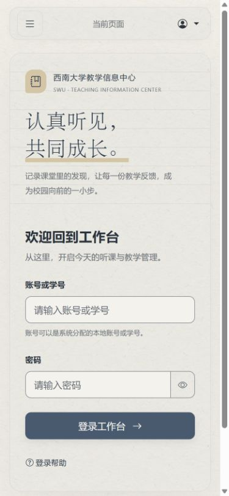
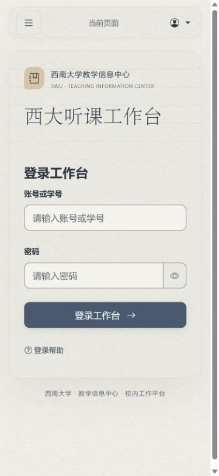
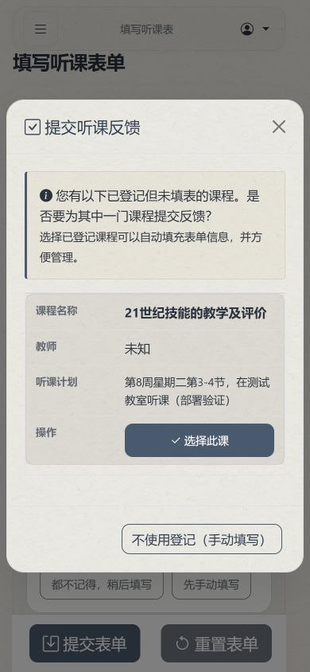
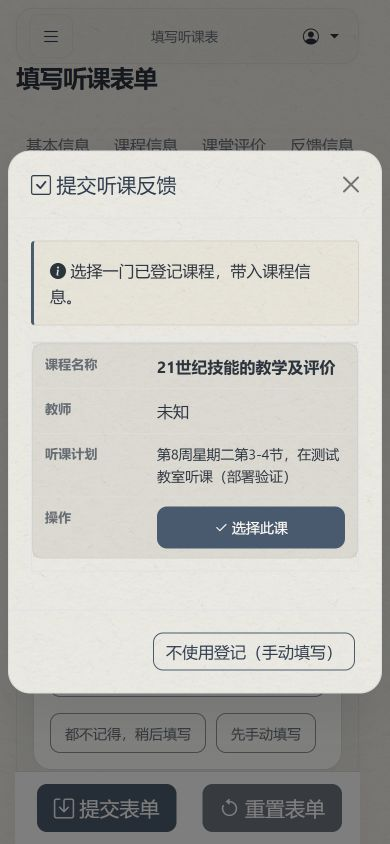
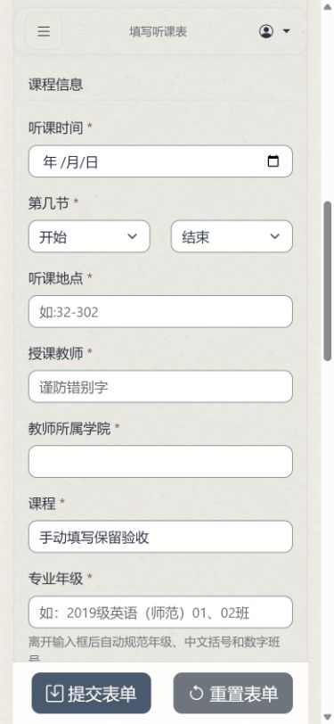
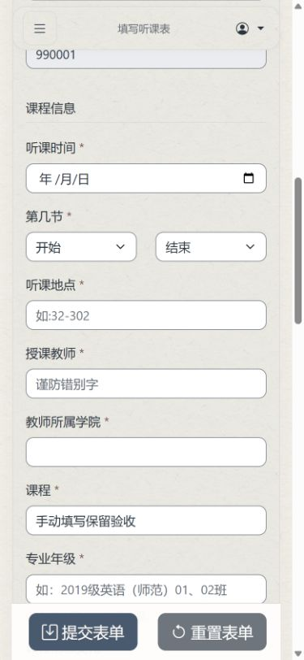

# 前端文案删减记录

> 后续修正：用户明确要求保留登录页理念和必要防错提示。原记录 C006、C012、C019、C094、C095、C096、C099、C149 已撤销或调整；当前文案与理由见 [有效提示恢复记录](2026-10-14-helpful-copy.md)。以下保留为第一轮历史记录，不代表这些条目的当前状态。

完成日期：2026-10-14。基线：`e2c005372185b00a1ed992db6c3c6e024d689336`（纸质弹窗调整已先合入 PR #14）。

判断标准：首次进入系统的信息员，能否据此知道在哪里填、填写什么、有什么要求、数据是否保存、出错怎样继续。只删除不帮助这些判断的重复介绍和开发实现说明。

已检查 62 个模板、14 个自有 JavaScript 文件、工作台动态文案，以及选课/拍照/登记接口的可见提示。实际记录 195 项删改，涉及 54 个应用文件；其中 40 项直接删除，其余为精简、改为操作用语或统一中文符号。

逐项原文、修改后文案、修改前位置和原因如下；较长源码片段在表中去掉标签展示，完整片段及本次逐文件差异见 [changes.json](2026-10-14-frontend-copy-trim/changes.json)。行号以基线为准。

## 保留的必要信息

- 账号与初始密码来源、登录帮助、忘记密码联系管理员。
- 必填标记、反馈至少50字、11位手机号、班级完整格式示例、多专业中文分号、无异常/变化填“无”。
- 未选评价默认为“非常好”的补集规则、未使用课件记为“无”、用户明确确认与独立推荐选择。
- 草稿保存/失败/冲突、照片保存结果未知、旧课表核对、定位不确定与地图高度示意。
- 驳回原因、审核状态、绑定后修改/删除限制、导入覆盖、永久删除、外发 DeepSeek 的确认。

## 手机端核查

截图使用独立本地验收数据库，宽度390px；“本地验收信息员”“未知教师”等是验收数据，未使用真实账号或提交业务表单。

| 步骤 | 检查结果 | 调整前 | 调整后 |
| --- | --- | --- | --- |
| 1 登录入口 | 删除宣传与重复账号说明；登录帮助保留并可打开，账号和初始密码来源仍可查。 |  |  |
| 2 选择登记课程 | 弹窗说明缩成一句；选择后课程、教室、规范班级带入，手动入口保持可用。 |  |  |
| 3 手动课程字段 | 格式示例保留，开发触发说明改为实际填写要求；390px无横向溢出。 |  |  |

管理员和异常分支依据源码及现有测试核对；没有逐页执行真实导入、审核、永久删除，也未重新测试手机实拍或GPS。截图不能证明完整无障碍合规。

## 逐项删改

### 信息员填表与记录

| 编号 | 基线位置 | 原文 | 删改后 | 原因 |
| --- | --- | --- | --- | --- |
| C001 | `app/templates/user/activity_center.html:10` | '查看预约、已提交表单和审核意见。' | '' | 标题、页签和操作入口已说明用途。 |
| C002 | `app/templates/user/lecture_reservation.html:7` | '选择课程并在当前页面完成听课预约。' | '' | 删除对当前页面布局和按钮的复述。 |
| C003 | `app/templates/user/profile.html:7` | '查看并维护个人信息、听课统计和最近活动。' | '' | 页面标题、分区和编辑按钮已说明用途。 |
| C004 | `app/templates/user/edit_profile.html:7` | '更新可编辑的信息，保存后会返回个人资料页。' | '' | 删除保存后导航的实现说明。 |
| C005 | `app/templates/user/edit_profile.html:19` | 请确保信息准确无误。带 * 的字段为必填项。 | 带 * 的字段为必填项。 | 保留必填标识含义，删除泛化要求。 |
| C006 | `app/templates/user/edit_profile.html:120` | 请输入有效的11位手机号码 | 删除 | 输入提示已有11位要求；格式错误反馈继续保留。 |
| C007 | `app/templates/user/profile.html:216` | 距上次交表(天) | 距上次交表（天） | 统一用户可见中文括号。 |
| C008 | `app/templates/user/_registration_panel.html:4` | 请输入课程名称、教师或课程号进行搜索... | 课程名称、教师或课程号 | 保留搜索范围，删除输入动作复述。 |
| C009 | `app/templates/user/_registration_panel.html:5` | 支持按课程名称、教师或课程号搜索。选择课程后可在当前页面完成登记。 | 删除 | 搜索框已列明范围，登记按钮已说明下一步。 |
| C010 | `app/templates/user/_registration_panel.html:46` | 请联系管理员在 系统设置 → 教学制度 配置学期起始周后再登记。 | 学期尚未设置，请联系管理员后再登记。 | 保留无法登记的原因和处理人，删除管理员设置路径。 |
| C011 | `app/templates/user/_registration_panel.html:77` | 选择课程后，登记信息和该课程的历史记录会在此处显示。 | 删除 | 已有“先选择一门课程”标题，无需介绍页面显示机制。 |
| C012 | `app/templates/user/_records_panel.html:75` | 查看提交状态、版本历史和审核意见。 | 删除 | 表格列和查看按钮已表达用途。 |
| C013 | `app/templates/user/_records_panel.html:66` | 暂无听课预约。可以先切换到“听课登记”选择课程。 | 暂无听课预约。可到“听课登记”选择课程。 | 保留空状态与可用入口，缩短操作指导。 |
| C014 | `app/templates/user/_records_panel.html:149` | 暂无听课表单。填写并提交第一份听课表单后，记录会显示在这里。 | 暂无听课表单。提交后可在此查看。 | 保留记录需提交后出现，删除重复因果说明。 |
| C015 | `app/templates/user/_records_panel.html:48` | 已绑定反馈表 ({{ item.bind_count }}) | 已绑定反馈表（{{ item.bind_count }}） | 统一用户可见中文括号。 |
| C016 | `app/templates/user/my_forms.html:83` | 已绑定反馈表 ({{ item.bind_count }}) | 已绑定反馈表（{{ item.bind_count }}） | 统一用户可见中文括号。 |
| C017 | `app/templates/user/lecture_form.html:267` | 可多选，请至少选择一种。 | 可多选，至少一项。 | 保留选择范围与必选条件。 |
| C018 | `app/templates/user/lecture_form.html:281` | 可多选。点击确认后，未选的适用项目将填写为“非常好”，选中的项目再逐项评价。 | 可多选；未选项目默认为“非常好”，所选项目逐项评价。 | 默认评价会影响提交结果，保留规则并去掉点击步骤复述。 |
| C019 | `app/templates/user/lecture_form.html:307` | 请根据实际听课情况独立选择是否推荐。 | 删除 | “是否推荐”题目及推荐/不推荐选项已经表达独立选择。 |
| C020 | `app/templates/user/lecture_form.html:351` | 已根据您的听课登记自动填充部分课程信息，您可以根据实际情况进行修改。 | 已带入登记课程信息，请核对。 | 保留填入状态和核对要求，删除自动实现描述。 |
| C021 | `app/templates/user/lecture_form.html:441` | 离开输入框后自动规范年级、中文括号和数字班号。 | 多个专业用中文分号分隔。 | 删除触发格式化的实现说明，保留多专业分隔的实际填写要求；格式示例与自动规范功能保留。 |
| C022 | `app/templates/user/lecture_form.html:448` | 一般三个方面:老师、教室、时间,没有变化填"无" | 教师、教室或时间有变化请说明；没有填“无”。 | 保留填写范围和无变化要求，使用中文符号。 |
| C023 | `app/templates/user/lecture_form.html:550` | 五十字以上,评价的内容实在且有针对性 | 至少50字，请写具体的课堂优点。 | 保留字数要求，用具体内容要求替代抽象形容。 |
| C024 | `app/templates/user/lecture_form.html:462` | 根据事实,没有则填"无" | 如实填写；没有填“无”。 | 保留异常或建议内容据实填写及填无的要求，统一中文符号。 |
| C025 | `app/templates/user/lecture_form.html:668` | 您有以下已登记但未填表的课程。是否要为其中一门课程提交反馈？ 选择已登记课程可以自动填充表单信息，并方便管理。 | 选择一门已登记课程，带入课程信息。 | 表格和按钮已展示待反馈课程，删除重复询问和“方便管理”。 |
| C026 | `app/templates/user/_site_capture.html:49` | 保留原照片，识别结果仍需核对。 | 原照片保留，请核对识别结果。 | 保留原图与结果需核对的实际含义。 |
| C027 | `app/templates/user/_site_capture.html:52` | 校园位置参考 | 删除 | 地图标题已说明选楼用途，删除装饰眉题。 |
| C028 | `app/templates/user/_site_capture.html:57` | 蓝点：采集位置 浅绿：附近楼栋 金色立体楼栋：当前选择（高度示意） | 蓝点：定位 浅绿：附近楼栋 金色：所选楼栋（高度示意） | 保留图例和高度限制，删除渲染形态描述。 |
| C029 | `app/templates/user/_site_capture.html:59` | 点击建筑或列表，再确认教学楼。 | 尚未选择教学楼 | 同屏已有选楼操作提示，选择栏仅展示当前状态。 |
| C030 | `app/services/schedule_availability.py:36` | 本学期课表尚未完成课程索引，请联系管理员。 | 本学期课表暂不可用，请联系管理员。 | 课程索引是内部处理步骤，保留不可用状态和联系路径。 |
| C031 | `app/services/schedule_availability.py:38` | 本学期课表尚未完成登记课程导入，请联系管理员。 | 本学期暂不能登记课程，请联系管理员。 | 登记索引导入是内部步骤，保留不可用状态和联系路径。 |

### 拍照、选课与动态提示

| 编号 | 基线位置 | 原文 | 删改后 | 原因 |
| --- | --- | --- | --- | --- |
| C032 | `app/static/js/site-capture.js:74` | 服务响应暂时无法读取，请刷新后重试。 | 暂未确认操作结果，请刷新查看。 | 响应无法读取时保存结果未知，不能表述为未完成；保留结果不确定与刷新查看路径，移除响应读取术语。 |
| C033 | `app/static/js/site-capture.js:170` | 拍清楚门牌号即可，系统会自动识别并查找课程。 | 请拍清楚门牌号。 | 相机阶段只保留清晰拍摄要求，后续查找与确认状态不变。 |
| C034 | `app/static/js/site-capture.js:205` | 正在上传照片并保存现场记录… | 正在保存照片… | 保留进行中状态，去掉连续内部步骤的重复说明。 |
| C035 | `app/static/js/site-capture.js:228` | 教室已确认，请继续核对助手选项。 | 教室已确认，请选择课程。 | 保留确认状态，用用户任务替换助手容器描述。 |
| C036 | `app/static/js/site-context-guide.js:139` | 重新参考现场线索 | 重新查找 | 按现有重新查找动作命名，不解释内部线索处理。 |
| C037 | `app/static/js/site-context-guide.js:160` | 补充问题 ${Math.min(2,(guidance?.questions_used\|\|0)+1)} / 2 | 问题 ${Math.min(2,(guidance?.questions_used\|\|0)+1)} / 2 | 去掉无额外含义的补充一词，保留题序和总数。 |
| C038 | `app/static/js/site-context-guide.js:172` | 先看候选课程 | 先看课程 | 按钮表达浏览课程即可，保留候选选择与人工确认流程。 |
| C039 | `app/static/js/site-context-guide.js:192` | 更多同范围课程 | 更多课程 | 同一结果区无需解释范围，扩大范围操作与提示不变。 |
| C040 | `app/static/js/site-context-guide.js:193` | 返回优先推荐 | 返回匹配结果 | 避免与后续是否推荐该课程的评价结论混淆。 |
| C041 | `app/static/js/site-building-map.js:391` | 有外观模型 · 地图位置待核对 | 外观参考 · 地图位置待核对 | 将模型术语改为用途说明，保留地图位置待核对。 |
| C042 | `app/static/js/site-building-map.js:535` | 点击建筑或列表，再确认教学楼。 | 尚未选择教学楼 | 选中摘要只显示当前选择状态，操作指引保留在状态区。 |
| C043 | `app/static/js/site-building-map.js:543` | 选择所在教学楼，再点击“使用此教学楼”。也可搜索楼号。 | 选择教学楼后，点击“使用此教学楼”。 | 缩短正常操作指引，不重复搜索控件的用途。 |
| C044 | `app/static/js/site-building-map.js:544` | 选择所在教学楼，再点击“使用此教学楼”。也可搜索楼号。 背景暂未加载，楼栋仍可选择。 | 地图背景暂未加载，仍可选择教学楼。 | 异常提示只保留背景未加载及仍可操作的状态，不重复正常指引。 |
| C045 | `app/static/js/site-door-crop.js:80` | 正在识别框选区域，原照片会保留… | 正在识别…（原照片保留） | 缩短进行中说明，保留原照片不被替换的信息。 |
| C046 | `app/static/js/listening-assistant.js:16` | 当前权威课表 | 当前课表 | 用户需要知道当前课表，源文件与旧课表核对信息仍保留。 |
| C047 | `app/static/js/listening-assistant.js:357` | 服务器返回了无法读取的结果 | 操作未完成，请重试或手动填写。 | 共用响应错误用操作结果和恢复路径表达。 |
| C048 | `app/static/js/listening-assistant.js:360` | 填表助手请求失败 | 操作未完成，请重试或手动填写。 | 保留失败状态，去掉请求术语。 |
| C049 | `app/static/js/listening-assistant.js:523` | 请输入班级。 | 删除 | 删除与听课班级标签重复的帮助文案，主表单班级要求不变。 |
| C050 | `app/static/js/listening-assistant.js:524` | 初始问题请选择类别；无法确定时可直接手动填写。 | 请选择你记得的信息；也可手动填写。 | 用用户记得的信息表达选择，保留手动出口。 |
| C051 | `app/static/js/listening-assistant.js:710` | 已确认的候选与来源 | 已确认课程 | 标题避免候选术语，实际课程字段与来源仍保留。 |
| C052 | `app/static/js/listening-assistant.js:710` | 确认前请核对课程、教师、教室、节次、班级和来源。 | 确认课程信息 | 标题不复述下方完整字段清单，旧课表与冲突提醒不变。 |
| C053 | `app/static/js/listening-assistant.js:730` | 来源批次：${candidate.source_batch_id} | 删除 | 删除不可供信息员核对的可见批次 ID，来源文件、请求批次、旧课表与冲突提醒保留。 |
| C054 | `app/static/js/listening-assistant.js:819` | 请选择教室处理方式 | 请确认实际教室。 | 用实际教室核对表达要求，保留确认按钮条件。 |
| C055 | `app/static/js/listening-assistant.js:954` | 当前学期没有可用备用批次，请手动填写。 | 该学期没有其他课表，请手动填写。 | 保留没有可用数据与手动路径，去掉备用批次术语。 |
| C056 | `app/static/js/listening-assistant.js:1054` | 暂时记不清也可以继续填写其他内容。已保留确认过的信息，可返回上一题或稍后补充。 | 已保留确认过的信息，可继续填写或返回上一题。 | 合并重复的继续填写说明，保留信息已保留和返回路径。 |
| C057 | `app/static/js/listening-assistant.js:1057` | 已切换为手动填写，请在下方补充课程信息。也可以重新开始引导。 | 请在下方补充课程信息。 | 手动区块及现有按钮已提供切换与重新查找，说明只指出填写任务。 |
| C058 | `app/static/js/listening-assistant.js:1057` | 现有信息还不能确定课程。可以修改答案、重新查找，或在下方手动填写。 | 暂无法确定课程，请补充信息或手动填写。 | 保留信息不足状态及主要恢复出口，具体动作留给按钮。 |
| C059 | `app/static/js/listening-assistant.js:1101` | 服务器没有返回可用的引导结果 | 暂时无法查找课程，请重试或手动填写。 | 保留查找失败与恢复路径，不描述服务器返回结构。 |
| C060 | `app/static/js/listening-assistant.js:1417` | 服务器没有返回可用的字段快照 | 课程信息暂未填入，请重试或手动填写。 | 保留填入失败与恢复路径，不暴露字段快照结构。 |
| C061 | `app/static/js/course-lookup.js:98` | 查询服务响应异常，请稍后重试。 | 课程查询失败，请稍后重试。 | 保留课程查询错误，去掉服务响应术语。 |
| C062 | `app/static/js/activity-center.js:54` | (${course.teacher_college}) | （${course.teacher_college}） | 统一中文括号，学院值保持不变。 |
| C063 | `app/static/js/activity-center.js:57` | 课程号: ${course.course_code \|\| '-'} \| 选课号: ${course.selection_code \|\| '-'} | 课程号：${course.course_code \|\| '-'} · 选课号：${course.selection_code \|\| '-'} | 统一中文冒号与分隔符，课程号与选课号保持不变。 |
| C064 | `app/static/js/activity-center.js:252` | ${course.course_name \|\| '未知课程'} \| ${course.teacher_name \|\| '未知教师'} \| ${course.class_time \|\| '时间未知'} (${course.course_code \|\| '-'}-${course.selection_code \|\| '-'}) | ${course.course_name \|\| '未知课程'} · ${course.teacher_name \|\| '未知教师'} · ${course.class_time \|\| '时间未知'}（${course.course_code \|\| '-'}-${course.selection_code \|\| '-'}） | 回退展示统一分隔符与中文括号，所有课程识别值及接口 course.text 优先级不变。 |
| C065 | `app/static/js/activity-center.js:450` | 暂无听课预约。可以先切换到“听课登记”选择课程。 | 暂无听课预约，可到“听课登记”选择课程。 | 缩短空状态，保留听课登记入口。 |
| C066 | `app/static/js/activity-center.js:484` | 暂无听课表单。填写并提交第一份听课表单后，记录会显示在这里。 | 暂无听课表单，提交后可在此查看。 | 缩短空状态，保留提交后出现记录的信息。 |

### 动态课程信息与错误提示

| 编号 | 基线位置 | 原文 | 删改后 | 原因 |
| --- | --- | --- | --- | --- |
| C067 | `app/services/listening_assistant_guide.py:379` | 请选择最符合的课程候选： | 请选择本次听课课程： | 去掉候选术语，保留课程选择与确认。 |
| C068 | `app/services/site_context_guidance.py:61` | 已尝试两次核对，仍不确定。可扩大范围查看课程，或修改信息。 | 仍无法确定课程，可扩大范围查看课程或修改信息。 | 不描述内部补问预算，保留不确定性与扩大范围/修改出口。 |
| C069 | `app/services/site_context_guidance.py:93` | 还有一处信息不确定，补充后我会重新匹配。 | 请补充下面的信息。 | 不复述紧邻问题的匹配流程，具体定位/门牌风险说明保留。 |
| C070 | `app/services/site_context_model.py:218` | 补问次数格式无效。 | 课程查找暂未完成，请重新查找。 | 保留模型校验和错误，只去掉用户不能调整的内部补问计数术语。 |
| C071 | `app/services/site_context_model.py:221` | 提问记录格式无效。 | 课程查找暂未完成，请重新查找。 | 保留模型校验和错误，只去掉问答记录结构术语。 |
| C072 | `app/services/site_context_model.py:255` | 该楼栋定位证据不足 | 无法凭定位确认该楼栋 | 将证据术语改为定位能力边界，仍明确定位不能确认此楼栋。 |
| C073 | `app/services/site_context_model.py:272` | 节次超出已配置作息，需手动核对 | 该节次无法自动核对，请手动核对 | 保留超出节次支持范围的手动核对限制，不误说成拍照时间异常。 |
| C074 | `app/blueprints/user/listening_assistant.py:609` | 填表助手仅使用后台配置的当前课表。 | 目前仅支持当前课表，请重新查找课程。 | 去掉后台配置视角，保留仅支持当前课表和重新查找路径。 |
| C075 | `app/blueprints/user/listening_assistant.py:619` | 填表助手仅使用后台配置的当前课表。 | 目前仅支持当前课表，请重新查找课程。 | 去掉后台配置视角，保留仅支持当前课表和重新查找路径。 |
| C076 | `app/blueprints/user/forms.py:674` | 表单版本标识无效，请从我的记录重新打开。 | 无法打开这份表单，请通过“查看记录”重新打开。 | 保留无效表单标识校验，恢复入口使用工作台实际按钮“查看记录”。 |
| C077 | `app/blueprints/user/forms.py:678` | 表单不存在，请从我的记录重新打开。 | 表单不存在，请通过“查看记录”重新打开。 | 同一恢复入口统一为实际“查看记录”，保留表单不存在状态。 |
| C078 | `app/blueprints/user/forms.py:712` | 听课记录标识无效，请重新打开记录后提交。 | 无法读取这次听课记录，请通过“查看记录”重新打开后提交。 | 保留记录标识校验与重新打开后提交的恢复步骤，使用实际入口。 |
| C079 | `app/blueprints/user/forms.py:1137` | 该表单已有更新版本，请从我的记录重新打开。 | 该表单已有更新版本，请通过“查看记录”重新打开。 | 同一恢复入口统一为实际“查看记录”，保留已有更新版本状态。 |
| C080 | `app/blueprints/user/site_capture.py:295` | 本次现场定位采集已结束。 | 本次定位已结束。 | 去掉现场采集术语，保留结束状态及409响应。 |
| C081 | `app/blueprints/user/site_capture.py:323` | 补问次数格式无效。 | 课程查找暂未完成，请重新查找。 | 前置校验实际会先返回该文案；与模型错误同步，保留次数校验和400状态。 |
| C082 | `app/blueprints/user/site_capture.py:325` | 提问记录格式无效。 | 课程查找暂未完成，请重新查找。 | 前置校验实际会先返回该文案；与模型错误同步，保留记录校验和400状态。 |
| C083 | `app/blueprints/user/reservations.py:191` | {course.course_name} \| {course.teacher.name if course.teacher else '未知'} \| {course.class_time or '时间未知'} ({course.course_code}-{course.selection_code}) | {course.course_name} · {course.teacher.name if course.teacher else '未知'} · {course.class_time or '时间未知'}（{course.course_code}-{course.selection_code}） | 接口 course.text 会覆盖前端回退展示；统一中文分隔符与括号，课程与选课号数据不变。 |
| C084 | `app/blueprints/user/reservations.py:215` | 获取课程列表失败: {str(e)} | 课程加载失败，请稍后重试。 | 仅替换课程搜索通用500异常展示，不改课表可用性、权限过滤或分页。 |
| C085 | `app/blueprints/user/reservations.py:287` | str(e) | 登记记录加载失败，请稍后重试。 | 仅替换登记历史通用500异常展示，课程身份独立400返回保留。 |
| C086 | `app/blueprints/user/reservations.py:389` | 登记失败: {str(e)} | 登记失败，请稍后重试。 | 仅替换登记通用500异常展示，回滚及必填、学期、时间、课程、禁听、人数限制分别返回保留。 |
| C087 | `app/blueprints/user/reservations.py:465` | 取消失败: {str(e)} | 取消登记失败，请稍后重试。 | 仅替换取消登记通用500异常展示，回滚、课程身份及表单绑定限制保留。 |
| C088 | `app/blueprints/user/reservations.py:540` | 获取预定列表失败: {str(e)} | 听课预约加载失败，请稍后重试。 | 仅替换我的预约列表通用500异常展示，历史课程核实状态和可编辑/删除条件保留。 |
| C089 | `app/blueprints/user/reservations.py:584` | 修改失败: {str(e)} | 修改失败，请稍后重试。 | 仅替换修改登记通用500异常展示，回滚及记录归属、绑定、当前课程、禁听、必填、时间、人数限制保留。 |
| C090 | `app/blueprints/user/reservations.py:604` | 删除失败: {str(e)} | 删除失败，请稍后重试。 | 仅替换删除登记通用500异常展示，回滚、归属和绑定限制保留。 |
| C091 | `app/blueprints/user/reservations.py:665` | str(e) | 已登记课程加载失败，请稍后重试。 | 此处实为unused_reservations选择课程API，不是登记历史；仅替换通用500展示，绑定与当前课程过滤保留。 |
| C092 | `app/blueprints/user/reservations.py:681` | 获取建议失败: {str(e)} | 时间建议暂未加载，请稍后重试。 | 无用户输入的时间建议通用500出口，仅替换异常展示，不改建议生成。 |
| C093 | `app/blueprints/user/reservations.py:317` | 请联系管理员在 系统设置 → 教学制度 配置学期起始周后再登记。 | 学期尚未设置，请联系管理员后再登记。 | 接口反馈与字段旁提示统一；信息员不需了解管理员设置路径，保留学期未设置原因及400校验。 |

### 登录、工作台与共用页面

| 编号 | 基线位置 | 原文 | 删改后 | 原因 |
| --- | --- | --- | --- | --- |
| C094 | `app/templates/auth/login.html:12` | 认真听见，共同成长。 | 西大听课工作台 | 以系统名称取代理念标题，首次用户可以确认当前系统。保留无障碍标题关联。 |
| C095 | `app/templates/auth/login.html:13` | 记录课堂里的发现，让每一份教学反馈，成为校园向前的一小步。 | 删除 | 理念宣传不提供登录或填写所需信息。 |
| C096 | `app/templates/auth/login.html:14` | 听课 · 记录 · 反馈 | 删除 | 功能装饰重复系统用途，不是单位署名。 |
| C097 | `app/templates/auth/login.html:18` | 欢迎回到工作台 | 登录工作台 | 直接说明当前操作，首次用户也适用。 |
| C098 | `app/templates/auth/login.html:19` | 从这里，开启今天的听课与教学管理。 | 删除 | 泛化操作介绍重复登录标题和按钮。 |
| C099 | `app/templates/auth/login.html:24` | 账号可以是系统分配的本地账号或学号。 | 删除 | 账号或学号标签已解释类型，登录帮助继续保留系统分配账号来源；去掉内部“本地账号”分类。 |
| C100 | `app/templates/auth/change_password.html:17` | 为了您的账户安全，请定期更换密码。新密码应包含字母、数字，长度至少6位。 | 删除 | 去掉顶部重复要求和泛化更换建议；字段旁保留实际至少6位要求。 |
| C101 | `app/templates/auth/change_password.html:48` | 密码长度至少6位，建议包含字母和数字 | 密码至少6位，建议包含字母和数字 | 在新密码字段旁保留唯一长度说明；字母数字为建议，与后端要求一致。 |
| C102 | `app/templates/main/public_index.html:9` | 听课、审核与教学管理，在一个工作台完成。 | 西大听课工作台 | 系统标题直接识别系统，避免泛化宣传。 |
| C103 | `app/templates/main/public_index.html:10` | 面向信息员、管理员和超级管理员的校内听课业务系统。 | 删除 | 角色分类不帮助首次用户完成登录。 |
| C104 | `app/templates/main/public_index.html:15` | 使用系统分配的账号登录，继续填写、审核或管理工作。 | 使用系统分配的账号登录。 | 保留账号来源，删除角色操作概述；初始密码与联系管理员说明保持。 |
| C105 | `app/templates/main/help.html:9` | 需要帮助时，从清晰的下一步开始。 | 使用帮助 | 用实际页面用途取代泛化标题。 |
| C106 | `app/templates/main/help.html:10` | 登录后，工作台会根据你的角色展示对应的任务、审核和管理入口。 | 删除 | 角色展示机制没有提供账号排障或填表操作信息。 |
| C107 | `app/templates/main/help.html:15` | 遇到登录或使用问题时，可以先按下面的顺序检查： | 登录与账号问题： | 列表不是有依赖的排障顺序，短标题描述实际帮助内容。 |
| C108 | `app/templates/main/help.html:19` | 登录后从工作台的待办或快捷入口继续操作。 | 信息员可从“填写听课表”提交反馈，从工作台的“查看记录”查看已交表单。 | 首次使用帮助指向真实入口，已核实工作台两种课表状态均有查看记录快捷项，不假定侧栏同名。 |
| C109 | `app/templates/main/about.html:9` | 让听课、审核与教学管理，在同一张工作台上清晰衔接。 | 西大听课工作台 | 系统名称取代宣传式介绍，单位标识保留。 |
| C110 | `app/templates/main/about.html:10` | 面向校内信息员、管理员和超级管理员的教学信息工作台。 | 删除 | 删除与公共入口重复的角色概述。 |
| C111 | `app/templates/main/about.html:15` | 工作台把听课记录、审核流程和教学管理入口放在同一个清晰的工作空间中。 | 用于提交听课反馈、查看审核结果。 | 关于页保留一条实际用途说明，去掉工作空间宣传。 |
| C112 | `app/templates/main/about.html:16` | 不同角色只会看到与职责相关的任务和操作，方便从待办继续推进工作。 | 删除 | 权限展示机制不帮助用户判断如何填写。 |
| C113 | `app/templates/main/workspace.html:8` | 校园听课手记 | 删除 | 删除装饰眉题，页面已有今日工作和用户标题。 |
| C114 | `app/templates/main/workspace.html:16` | 可以从快捷入口开始新的工作。 | 删除 | 保留空状态，删除重复描述右侧已经可见的快捷入口。 |
| C115 | `app/templates/main/_leave_reminder_modal.html:18` | 提交时系统会自动将表单定义为第{{ leave_prompt.leave_week }}周请假补交表。 | 补交表将计入第{{ leave_prompt.leave_week }}周。 | 删除自动定义实现介绍，保留补交表归属周这一业务含义。 |
| C116 | `app/templates/success.html:7` | 表单已进入审核流程，以下是本次提交的摘要。 | 表单已提交，等待审核。 | 删除下方页面结构介绍，保留提交完成和后续审核状态。 |
| C117 | `app/templates/list.html:60` | 还没有提交过听课表单 | 删除 | 与暂无表单记录标题同义重复，保留标题和填写入口。 |
| C118 | `app/templates/main/index.html:7` | 请从统一工作台继续处理任务。 | 删除 | 兼容入口保留入口已更新和返回按钮，删除重复迁移说明；不改路由。 |
| C119 | `app/templates/main/user_index.html:7` | 信息员工作已集中到统一工作台。 | 删除 | 兼容入口保留入口已更新和返回按钮，删除重复迁移说明；不改路由。 |
| C120 | `app/templates/main/manager_index.html:7` | 管理员工作已集中到统一工作台。 | 删除 | 兼容入口保留入口已更新和返回按钮，删除重复迁移说明；不改路由。 |
| C121 | `app/templates/main/admin_index.html:7` | 管理员工作已集中到统一工作台。 | 删除 | 兼容入口保留入口已更新和返回按钮，删除重复迁移说明；不改路由。 |
| C122 | `app/ui/workspace.py:85` | 查找当前课表中的课程信息。 | 删除 | 删除重复查询/查看按钮的概述，保留按课表状态选择主按钮逻辑。 |
| C123 | `app/ui/workspace.py:85` | 查看已提交的记录。 | 删除 | 删除重复查询/查看按钮的概述，保留按课表状态选择主按钮逻辑。 |
| C124 | `app/ui/workspace.py:105` | 继续今天的听课安排，或查看已经提交的记录。 | 删除 | 标题下概述重复填写与查看入口，没有补充要求或状态。 |
| C125 | `app/ui/workspace.py:98` | 草稿已经自动保存，可以从上次位置继续。 | 草稿已保存 | 保留草稿保存状态，去掉重复继续按钮的说明，不暗示滚动位置恢复。 |
| C126 | `app/ui/workspace.py:23` | {pending_forms} 份表单等待处理，进入审核队列继续工作。 | {pending_forms} 份待审核 | 保留数量和审核状态，删除对审核队列按钮的复述。 |
| C127 | `app/ui/workspace.py:125` | 先处理 {snapshot.pending_forms} 份待审核表单，再查看部门提交情况。 | 删除 | 管理员的数量、状态已在指标和待办展示，删除第三次概述和非必要操作顺序。 |
| C128 | `app/ui/workspace.py:127` | 当前没有待审核表单，可以查看部门提交情况。 | 删除 | 管理员的数量、状态已在指标和待办展示，删除第三次概述和非必要操作顺序。 |
| C129 | `app/ui/workspace.py:158` | 全局共有 {snapshot.pending_forms} 份待审核表单，请优先完成审核。 | 删除 | 超级管理员的待审状态已有指标和待办，删除重复概述；异常任务说明保持。 |
| C130 | `app/ui/workspace.py:160` | 当前没有待审核表单，可以查看全局提交情况。 | 删除 | 超级管理员的待审状态已有指标和待办，删除重复概述；异常任务说明保持。 |
| C131 | `app/templates/partials/_empty_state.html:2` | {{ description }} | {{ description }} | 仅避免删减后空段落的间距；保留其他调用方的有效描述能力。 |
| C132 | `app/templates/view.html:80` | 课程(总标题) | 课程（总标题） | 沿用已确认的中文括号规范，兼容表单详情标签含义不变。 |
| C133 | `app/templates/view.html:144` | 课程反馈(优点) | 课程反馈（优点） | 沿用已确认的中文括号规范，兼容表单详情标签含义不变。 |

### 管理员页面

| 编号 | 基线位置 | 原文 | 删改后 | 原因 |
| --- | --- | --- | --- | --- |
| C134 | `app/templates/admin/_settings_automation.html:9` | 状态检查只返回可展示的健康摘要，不显示密钥或原始连接信息。 | 删除 | 删除不指导操作的内部安全实现说明。 |
| C135 | `app/templates/admin/_settings_automation.html:40` | 上传后先生成 staged 预览；只有确认启用后才切换 active 数据集。 | 上传后先预览，确认后启用。 | 保留启用步骤，删除内部状态术语。 |
| C136 | `app/templates/admin/_settings_automation.html:133` | 先预览范围和缓存，再确认启动；自动审核只生成证据和建议，不改变人工审核字段。 | 先预览，再启动。审核结果仍需人工确认。 | 保留操作顺序与人工决定边界。 |
| C137 | `app/templates/admin/_settings_automation.html:190` | 每次变更都会形成可追溯的规则 revision，批次读取固定版本。 | 规则修改后保存为新版本，已启动的审核仍使用启动时的版本。 | 保留版本修改对正在运行审核的影响，移除 revision 内部词。 |
| C138 | `app/templates/admin/_settings_imports.html:3` | 导入全校课表或进入通讯录工具，操作结果会在当前页面反馈。 | 删除 | 入口按钮已明确用途，删除重复说明与反馈位置解释。 |
| C139 | `app/templates/admin/_settings_imports.html:11` | 进入对应业务页面继续筛选和导出，避免重复配置筛选条件。 | 删除 | 删除链接式入口的布局理由。 |
| C140 | `app/templates/admin/_settings_imports.html:19` | 清空操作需要密码和二次确认，完成后会在此处保留结果。 | 清空数据前需验证当前账号密码。 | 保留密码要求，删除反馈位置说明；弹窗保留不可恢复与二次确认。 |
| C141 | `app/templates/admin/_settings_imports.html:24` | 系统版本v1.6 | 删除 | 删除未读取实际部署版本的硬编码版本行。 |
| C142 | `app/templates/admin/_settings_imports.html:24` | 数据库状态正常 | 删除 | 删除未经健康检查证实的硬编码正常状态行。 |
| C143 | `app/templates/admin/import_forms_excel.html:47` | 导入后数据直接写入教学反馈表数据表（lecture_forms）。 | 导入后将新增听课反馈记录。 | 保留写入后果，删除数据库表名。 |
| C144 | `app/templates/admin/import_forms_excel.html:50` | 该功能仅对超级管理员开放。 | 删除 | 已进入受限页面无需重复权限介绍，后台权限校验保留。 |
| C145 | `app/templates/admin/import_forms_excel.html:53` | reviewer_id 自动写入当前导入人ID，registration_id 与表单组ID均由系统维护，不通过Excel填写。 | 审核人默认记为当前导入账号，无需填写内部编号。 | 保留审核人归属，删除内部字段名。 |
| C146 | `app/templates/admin/review_forms.html:26` | 先设置时间与审核范围；加载后，队列会留在主工作区，筛选项自动收起。 | 选择时间和人员范围后加载表单。 | 保留必要步骤，删除队列位置与自动收起说明。 |
| C147 | `app/templates/admin/review_forms.html:195` | 从左侧列表选择一份表单，查看摘要和规则检查。 | 选择表单查看详情。 | 删除不适用于手机的方位和重复功能介绍。 |
| C148 | `app/templates/admin/statistics.html:10` | 先查看核心指标与趋势，再按需进入专项统计或请假管理。 | 删除 | 标题、指标和导航已说明用途，删除人为浏览顺序。 |
| C149 | `app/templates/admin/review_assessment_stats.html:76` | 数值 0 表示有效结果；无记录时才显示空状态。 | 删除 | 删除渲染约定说明，保留实际数据和空状态。 |
| C150 | `app/templates/admin/course_feedback_management.html:16` |  维护课程、教师与禁听规则。  查询课程并完成听课登记。  | 删除 | 标题与操作已表达用途，删除两个分支的重复副文案。 |
| C151 | `app/templates/admin/course_feedback_management.html:420` | 导入后系统会按“禁听该教师全部课程”的当前实现方式，对所有信息员批量生成禁听记录。 | 导入后，所有信息员都将被禁止听该教师的全部课程。 | 删除实现措辞，保留全部用户和全部课程的影响范围。 |
| C152 | `app/templates/admin/department_monthly_assessment_stats.html:19` | 考评情况为系统根据当前考评规则和数据自动给出，不代表真实考评情况，请认真核实，建议核实无误后保存或导出数据。 | 考评结果由现有规则和记录计算，请核实后保存或导出。 | 精简长句，保留计算依据及核实提醒，不删除统计口径。 |
| C153 | `app/templates/admin/submission_count_stats.html:55` | 奖励表情况为系统根据当前奖励表规则和数据自动给出，不代表真实考评情况，请认真核实，建议核实无误后保存或导出数据。 | 奖励表数量由现有规则和记录计算，请核实后保存或导出。 | 精简长句，保留计算依据及核实提醒，不删除统计口径。 |
| C154 | `app/static/js/automation-center.js:205` | 自动审核批次已启动，进度会在当前页面更新。 | 自动审核已启动。 | 保留启动结果，删除进度显示位置。 |
| C155 | `app/static/js/automation-center.js:414` | 数据集已启用，历史记录和覆盖统计已刷新。 | 已启用。 | 保留成功反馈，删除组件刷新实现描述。 |
| C156 | `app/templates/admin/_settings_automation.html:189` | 规则与 revision | 审核规则 | 用中文版本名称替代内部 revision 术语，版本行为不变。 |
| C157 | `app/templates/admin/_settings_automation.html:192` | 新建 revision | 新建规则版本 | 用中文版本名称替代内部 revision 术语，版本行为不变。 |
| C158 | `app/templates/admin/_settings_automation.html:229` | 新建规则 revision | 新建规则版本 | 用中文版本名称替代内部 revision 术语，版本行为不变。 |
| C159 | `app/templates/admin/_settings_automation.html:255` | 保存 revision | 保存版本 | 用中文版本名称替代内部 revision 术语，版本行为不变。 |
| C160 | `app/static/js/automation-center.js:447` | 规则 revision 已保存。 | 规则版本已保存。 | 与规则编辑标签统一，保留成功结果。 |
| C161 | `app/templates/admin/_settings_automation.html:196` | severity | 风险等级 | 仅将展示标签改为中文，JSON 格式要求及字段钩子保持不变。 |
| C162 | `app/templates/admin/_settings_automation.html:196` | parameters | 参数 | 仅将展示标签改为中文，JSON 格式要求及字段钩子保持不变。 |
| C163 | `app/templates/admin/_settings_automation.html:233` | >规则 key | >规则标识 | 仅将展示标签改为中文，JSON 格式要求及字段钩子保持不变。 |
| C164 | `app/templates/admin/_settings_automation.html:241` | >severity | >风险等级 | 仅将展示标签改为中文，JSON 格式要求及字段钩子保持不变。 |
| C165 | `app/templates/admin/_settings_automation.html:248` | >parameters JSON | >规则参数（JSON） | 仅将展示标签改为中文，JSON 格式要求及字段钩子保持不变。 |
| C166 | `app/static/js/automation-center.js:430` | 规则 key、处理器和变更原因不能为空。 | 规则标识、处理器和变更原因不能为空。 | 错误提示与中文字段标签统一，保留必填要求。 |
| C167 | `app/static/js/automation-center.js:437` | parameters 必须是有效 JSON。 | 规则参数必须是有效 JSON。 | 仅中文化字段名称，保留 JSON 格式错误及修正要求。 |
| C168 | `app/static/js/automation-center.js:441` | parameters 必须是 JSON 对象。 | 规则参数必须是 JSON 对象。 | 仅中文化字段名称，保留 JSON 对象类型要求。 |
| C169 | `app/templates/admin/_settings_automation.html:243` | info | 提示 | 中文化选项显示文本，option value 与默认选择保持不变。 |
| C170 | `app/templates/admin/_settings_automation.html:244` | review | 建议复核 | 中文化选项显示文本，option value 与默认选择保持不变。 |
| C171 | `app/templates/admin/_settings_automation.html:245` | high | 高风险 | 中文化选项显示文本，option value 与默认选择保持不变。 |
| C172 | `app/templates/admin/_settings_automation.html:246` | unknown | 无法判断 | 中文化选项显示文本，option value 与默认选择保持不变。 |
| C173 | `app/templates/admin/auto_review_results.html:35` | schedule | 课表核对 | 证据栏目改为中文，保留 data-evidence-source 和证据内容。 |
| C174 | `app/templates/admin/auto_review_results.html:36` | rule | 规则检查 | 证据栏目改为中文，保留 data-evidence-source 和证据内容。 |
| C175 | `app/templates/admin/auto_review_results.html:37` | text | 文字检查 | 证据栏目改为中文，保留 data-evidence-source 和证据内容。 |
| C176 | `app/templates/admin/auto_review_results.html:38` | history | 历史记录 | 证据栏目改为中文，保留 data-evidence-source 和证据内容。 |
| C177 | `app/templates/admin/auto_review_results.html:39` | llm | 智能分析 | 证据栏目改为中文，保留 data-evidence-source 和证据内容。 |
| C178 | `app/templates/admin/auto_review_results.html:40` | system | 处理状态 | 证据栏目改为中文，保留 data-evidence-source 和证据内容。 |
| C179 | `app/templates/admin/review_forms.html:291` | schedule | 课表核对 | 证据栏目改为中文，保留 data-evidence-source 和证据内容。 |
| C180 | `app/templates/admin/review_forms.html:292` | rule | 规则检查 | 证据栏目改为中文，保留 data-evidence-source 和证据内容。 |
| C181 | `app/templates/admin/review_forms.html:293` | text | 文字检查 | 证据栏目改为中文，保留 data-evidence-source 和证据内容。 |
| C182 | `app/templates/admin/review_forms.html:294` | history | 历史记录 | 证据栏目改为中文，保留 data-evidence-source 和证据内容。 |
| C183 | `app/templates/admin/review_forms.html:295` | llm | 智能分析 | 证据栏目改为中文，保留 data-evidence-source 和证据内容。 |
| C184 | `app/templates/admin/review_forms.html:296` | system | 处理状态 | 证据栏目改为中文，保留 data-evidence-source 和证据内容。 |
| C185 | `app/templates/admin/_settings_imports.html:43` | 课程表 (courses) | 课程 | 删除面向开发者的数据库表名，保留实际删除对象和 option value。 |
| C186 | `app/templates/admin/_settings_imports.html:43` | 教师表 (teachers) | 教师 | 删除面向开发者的数据库表名，保留实际删除对象和 option value。 |
| C187 | `app/templates/admin/_settings_imports.html:43` | 场地表 (venues) | 场地 | 删除面向开发者的数据库表名，保留实际删除对象和 option value。 |
| C188 | `app/templates/admin/_settings_imports.html:43` | 听课记录表 (lecture_forms) | 听课记录 | 删除面向开发者的数据库表名，保留实际删除对象和 option value。 |
| C189 | `app/templates/admin/_settings_imports.html:43` | 禁听记录表 (listening_bans) | 禁听记录 | 删除面向开发者的数据库表名，保留实际删除对象和 option value。 |
| C190 | `app/templates/admin/_settings_imports.html:43` | 用户表 (users) | 用户 | 删除面向开发者的数据库表名，保留实际删除对象和 option value。 |
| C191 | `app/templates/admin/_settings_imports.html:43` | 部门表 (departments) | 部门 | 删除面向开发者的数据库表名，保留实际删除对象和 option value。 |
| C192 | `app/templates/admin/_settings_imports.html:43` | 群组表 (groups) | 小组 | 删除面向开发者的数据库表名，保留实际删除对象和 option value。 |
| C193 | `app/templates/admin/review_form.html:350` | 请填写您的审核意见，如果不修改表格内容可直接提交，审核意见将默认显示为"无" | 填写审核意见（可留空） | 精简输入提示，保留可留空行为，默认值逻辑不变。 |
| C194 | `app/templates/admin/review_form.html:352` | 系统将自动记录您对表单的修改内容并附加到审核意见后 | 修改记录会自动附在审核意见后。 | 保留自动附加修改记录的业务后果。 |
| C195 | `app/templates/admin/review_forms.html:2211` | DeepSeek 结构化结果已验证。 | 智能分析已完成。 | 避免将非空结构化结果误称为内容已核实，保留分析完成状态。 |

## 配套调整与验证

- 8 个修改过的动态脚本，共 9 处引用更新缓存版本为 `20261014-copy`，保证已有用户可加载新文案。
- 同步现有测试中的8处旧文案/资源版本期望；操作、状态、权限和课程判断断言保留。
- 62 个模板全部解析通过；37 个修改模板的 id/name/data属性/value 与基线逐项一致。
- 14个JavaScript语法检查及194项现有前端测试通过。
- 相关Python和模板回归244项、160个子测试通过：完整范围首次239项通过；3项旧文案断言同步后，助手模板文件22项复验全部通过；最后补齐接口提示后，2项学期未配置时禁止登记的现有用例通过。
- 10组角色/课表/草稿/待审/故障情境对比：工作台除摘要与待办说明外的业务输出不变。

尚保留的技术配置：管理员需要填写的JSON参数、服务名、状态数据及统计去重口径仍有操作用途，没有为减少字数隐藏它们。源码注释、已隐藏且不出现在页面上的内部文案不算删减对象。
