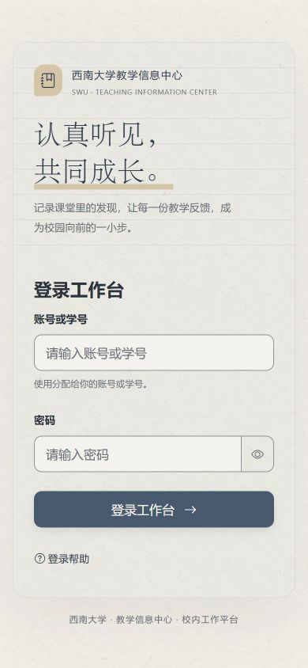
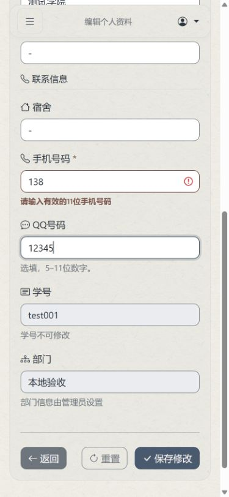

# 有效提示与登录氛围恢复记录

日期：2026-10-14。基线：`4733573b4d169a60f4d3b1b48898bc7c8e6394bf`（PR #15）。

用户纠正：保留“认真听见，共同成长”和理念段落；必要填写要求、错误提醒与防呆设计不能因精简而删掉。语气可以有青春感，但要有分寸。

> 后续补齐：本轮恢复只覆盖 `/auth/login`，漏掉 `/` 未登录首页。用户本地截图暴露该遗漏后，已将首页理念和品牌排版对齐，核实实际5088调试服务；同时按用户要求更新有课表调试的默认课表。见 [首页与本地课表修正记录](2026-10-14-public-entry.md)。

重新逐项复核前一轮 40 项直接删除，恢复其中 7 项有实际价值的短说明和用户明确认可的登录氛围，其余 33 项继续删除。另恢复一项被替换的登录标题。C113“校园听课手记”属于可选氛围，本次没有恢复，避免将登录页要求扩散成整站宣传回滚。

## 逐项修正

| 前轮记录 | 位置 | 当前文案或行为 | 恢复理由 |
| --- | --- | --- | --- |
| C094 | 登录左栏 | 认真听见，／共同成长。 | 用户明确认可；恢复换行、衬线字体和原有暖色下划线。 |
| C095 | 登录左栏 | 记录课堂里的发现，让每一份教学反馈，成为校园向前的一小步。 | 用户明确认可，保留学生参与感。 |
| C096 | 登录左栏 | 听课 · 记录 · 反馈 | 原有短标语，桌面保留，手机沿用原有隐藏规则。 |
| C099 | 账号框下 | 使用分配给你的账号或学号。 | 说明账号来源，去掉内部分类“本地”。 |
| C006 | 可编辑手机号下 | 请输入有效的11位手机号码 | 有值时 placeholder 不可见，因此保留持续可见的格式提示。 |
| C019 | 推荐题 | 是否推荐可独立选择，不要求所有项目都是“非常好”。 | 避免沿用旧规则，不改变推荐与评分逻辑。 |
| C012 | 我的表单 | 点击“查看”，可查看表单详情和审核意见。 | 说明审核意见入口；仅有表单时显示。 |
| C149 | 管理员统计结果 | 0 是实际统计结果；没有记录会另行提示。 | 区分真实零值与没有数据，仅在统计页显示。 |
| 新增 | 可编辑 QQ 下 | 选填，5–11位数字。 | 说明可留空及实际长度要求。 |

## 防错交互

手机号、QQ 第一次输入过程中不立即报红；离开字段后检查非空内容。格式错误在字段旁显示明确文字，并通过 `aria-invalid`、`aria-describedby` 和礼貌播报关联输入框。改正、清空可选 QQ 或重置表单后清除错误，恢复常规提示。

提交时检查手机必填和格式、QQ 的非空格式，错误时聚焦对应字段并保留输入。原生手机必填失败同样显示中文就地提示。只读字段不绑定校验事件，不因历史资料格式阻断其他修改。沿用前后端原有格式与去除两端空白的规则，没有扩大或收紧资料权限。

错误提示保持具体：“请输入有效的11位手机号码”“请输入有效的QQ号码（5–11位数字）”。温度放在登录理念与“分配给你”的自然语气里，错误提醒不玩梗、不增加表情或夸张鼓励。

班级格式示例、至少50字、实际评分选项、未选默认“非常好”、草稿/照片保存失败、审核原因、定位不确定、导入和删除确认等原有有信息量的提示继续保留。

## 验证

新增 9 项联系信息行为测试；最初 8 项在原模板上全部失败，修正后通过，再补充重置和只读字段用例。联系信息与填表助手相关 Node 测试共 38 项通过；登录、个人资料与教学日历资料集成 Python 测试共 10 项通过。独立复核发现的原生 `pattern` 与 `trim()` 语义冲突已修正，未引入额外格式 `pattern`。

浏览器核实：手机390px登录无横向溢出，保留原有理念和纸质排版；375px资料页首次输入不足不报红，离开后显示格式错误，改正后立即清除。桌面验证空手机号提交显示“请输入手机号码”，错误格式提交显示11位号码要求，并聚焦字段；重置后旧错误清除、常规提示恢复。使用独立验收数据库，未修改真实用户资料，也未提交业务表单。桌面登录截图使用已登录的验收账号，包含对应导航，不代表匿名页导航。

[桌面排版截图](2026-10-14-helpful-copy/03-login-desktop.png)

部署结果另行记录；本文的本地检查不等同手机实拍、GPS 或全流程无障碍验收。
