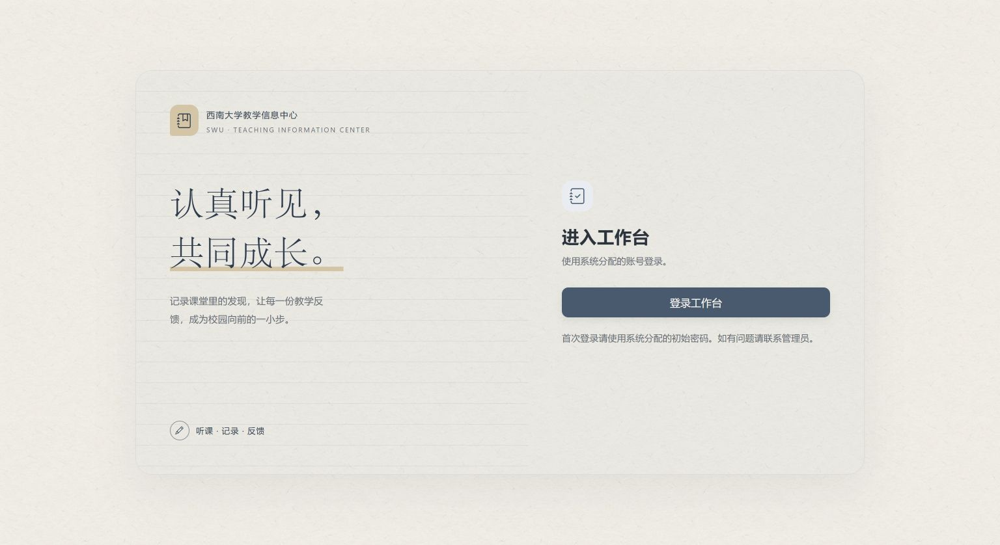
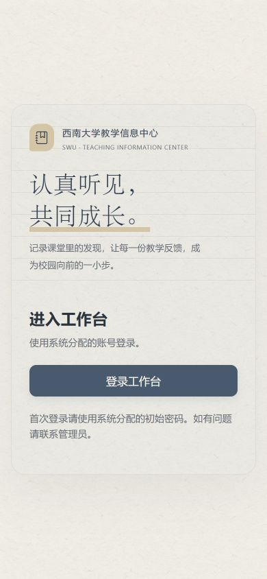

# 未登录首页补齐与最新本地课表

日期：2026-10-14。基线：`19b4568c51f7a30f0f09c991d121097ca5df18f7`（PR #16）。

## 首页遗漏的原因与修正

上一轮只恢复了 `app/templates/auth/login.html`（`/auth/login`）。未登录访问 `/` 时，`main.index` 渲染另一个模板 `app/templates/main/public_index.html`，其中仍为“西大听课工作台”，缺少原理念段落。因此用户截图中的首页没有恢复，并非用户本地代码未同步。

现已让首页左栏与登录页使用同样的单位标记、英文署名、“认真听见，共同成长”、原理念段落和短标语，沿用原纸张纹理、字体和暖色下划线。首页右侧保留单一登录入口，以及账号和初始密码来源提示。

用户实际运行的是本仓库 `5088` 无课表调试服务，模板自动重载关闭。使用原启动器重启该已确认的进程后，核实首页及登录跳转正常；重启前后全部业务表指纹相同，7用户、0表单，未重置账号或测试数据。

## 有课表环境默认配置

用户随后要求自动指定最新课表。`tools/debug_schedule.py` 的默认文件已从历史课表更新为仓库根目录的 **`26-27-1全校课表(1).xlsx`**，学期 **2026-2027-1**，第一教学周周一 **2026-08-31**（用户此前确认）。历史日历及显式文件、日期覆盖仍保留。

使用 **`本地调试.cmd`** 启动或重启有课表环境时，会检查这份文件的内容指纹：相同则复用，内容更新则导入。普通有课表环境默认5087；**`无课表测试.cmd`** 对应独立5088环境，不受该默认课表变更影响。

真实文件只读核实18208行、学期1、学年2026-2027；SHA256：`32e9d0744d45ac09fbb5f66548224ea5c735618cc79c5c282c38000644606fc4`。先在有课表调试库副本演练，再对本地有课表库直接调用课表准备函数。实际已存在相同课表，因此复用18208条课程和52429条匹配索引，课程匹配与登记均就绪。连续两次执行未增加重复数据。

原有用户、密码、表单、登记、13份照片记录、3份草稿及其他设置的指纹保持不变。有课表库备份保存于忽略的本地验收目录。此次配置没有调用会重置管理员密码的账号初始化入口。

## 验证

- 新增真实 `/` 和 `/auth/login` 入口回归：修复前首页失败，修复后两入口均通过；公共页和登录相关检查6项通过。
- 新增7项默认课表、日历、显式覆盖与指纹复用测试，先红后绿；连同公共页面、登录与原有启动器源码契约，当前执行的26项检查全部通过。
- 本地实际服务检查了未登录首页与登录跳转；无课表重启、有课表准备前后分别核对数据，保护既有测试成果。

手机390px检查：理念和操作入口均可见，页面宽度与内容宽度均390px，没有横向溢出。

两类调试数据库和原始课表仍在各自位置；本文不将“默认指定这份文件”描述为后台自动下载或任意扫描未来学期课表。
